# ⭐ Review Posts

**Turn your 5-star reviews into Instagram posts in your own brand, in about 5 minutes a week.**

Works for any business: roofers, dentists, landscapers, salons, restaurants, and more. Give it your website once. It picks up your logo, colors and fonts, finds good background photos, and asks where your reviews live (Google, Yelp, BBB, Facebook, Trustpilot and others). After that, you just say **"make review posts"**.

### Made for WorleyByrd Roofing & Restoration

These are real posts from real Google, BBB and website reviews, in WorleyByrd's navy and gold, on their own drone photos and on neighborhood aerials from the areas they serve:

<table>
<tr>
<td>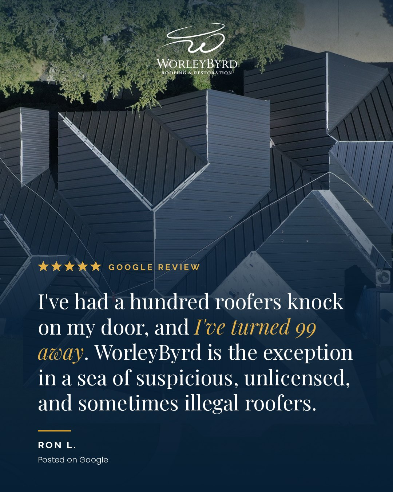</td>
<td>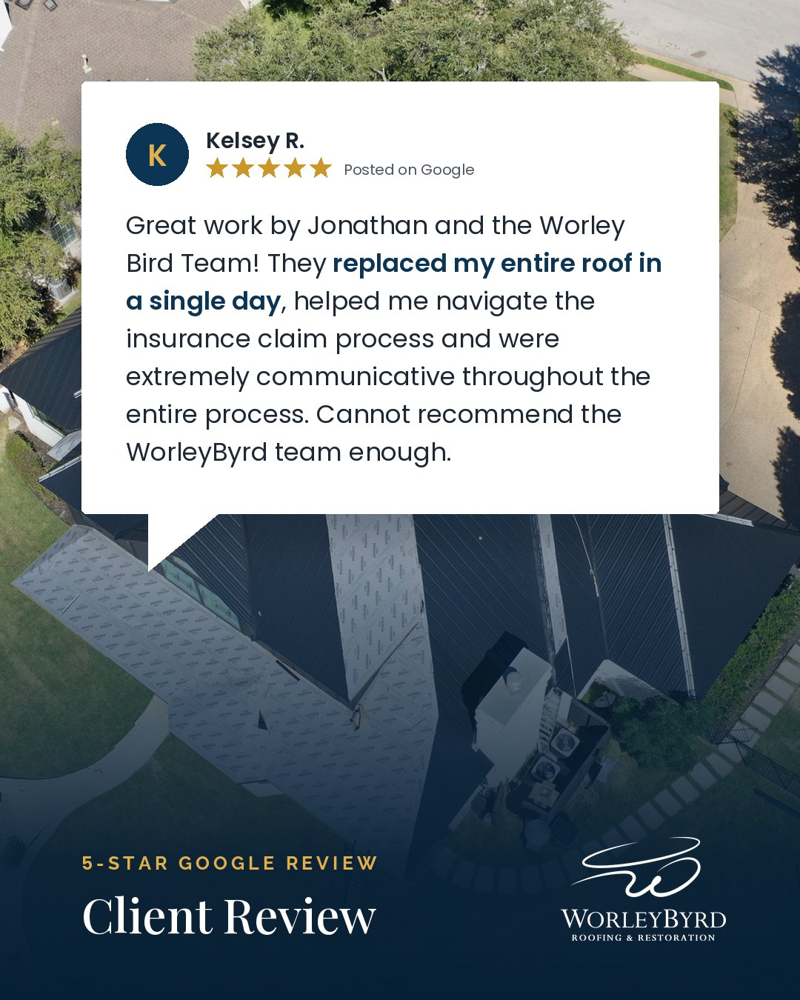</td>
<td>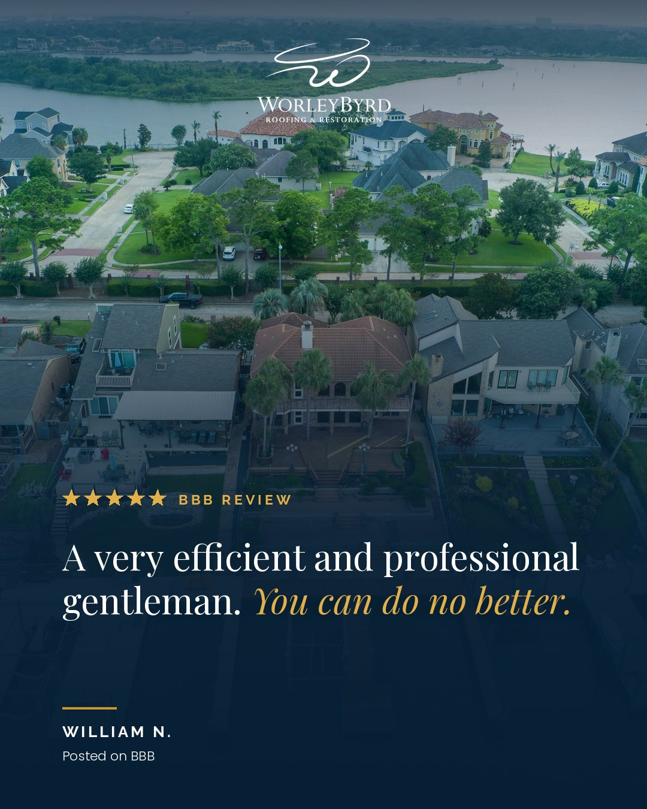</td>
<td>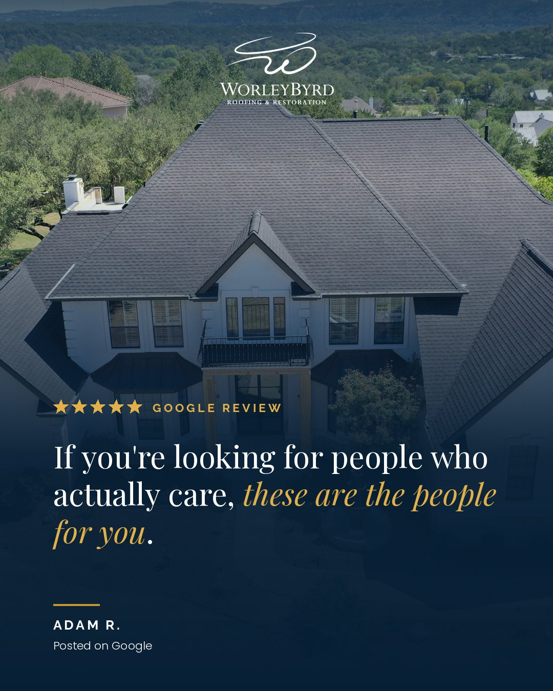</td>
</tr>
<tr>
<td>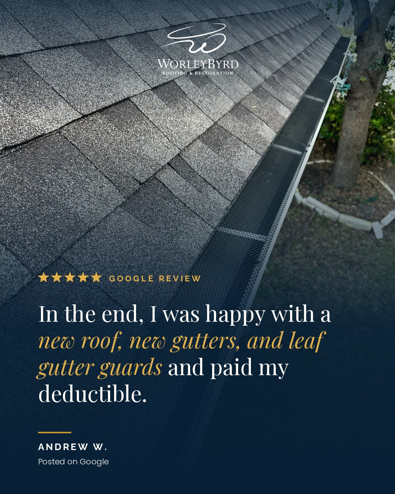</td>
<td>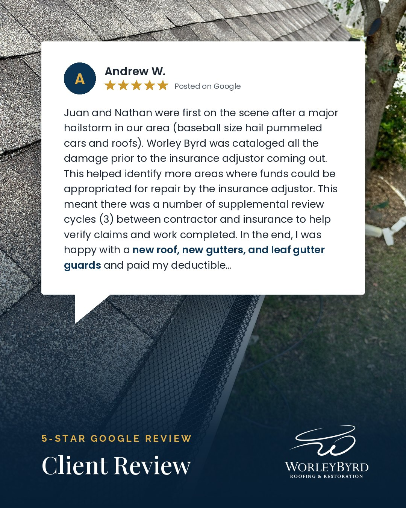</td>
<td>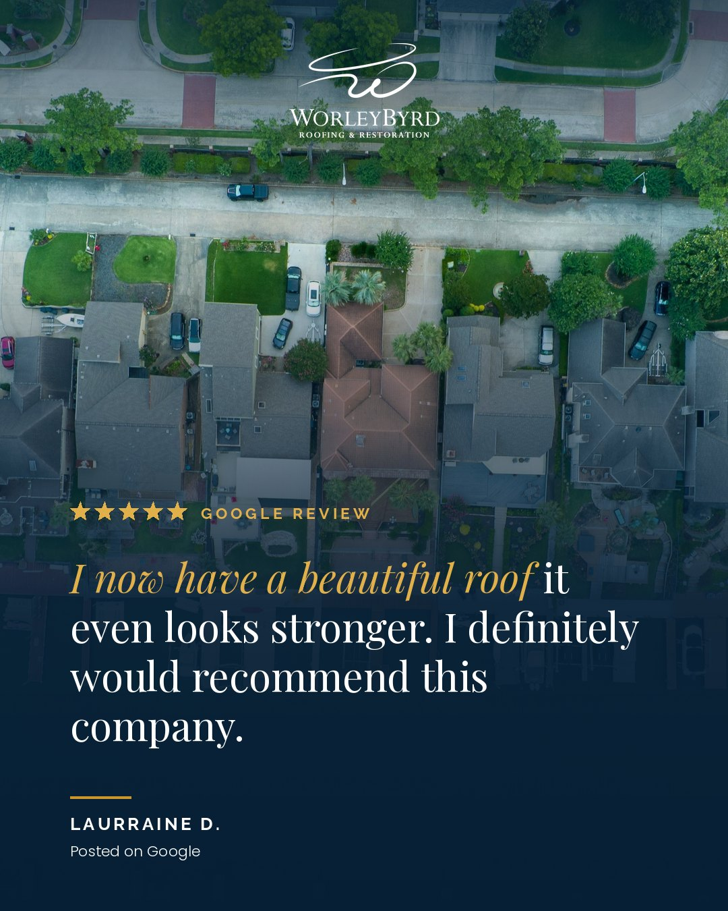</td>
<td>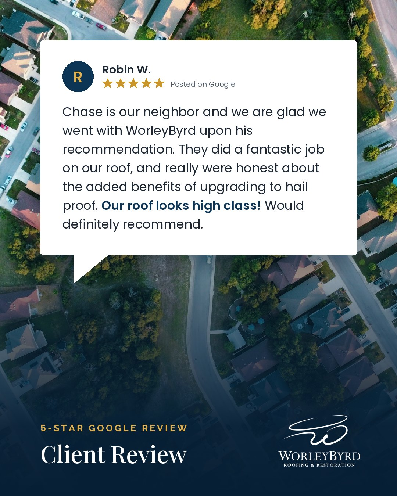</td>
</tr>
</table>

- **Short reviews** get a big quote on a photo.
- **Longer reviews** get a review card.
- **Very long reviews** become a 2-slide carousel (bottom left). That customer attached a photo of his new roof to his review, so his own photo became the background.
- **Every post says where the review came from:** Google, BBB, or the website.

### Same tool, any brand

The same skill, set up for two made-up businesses: a landscaper with photos, and a dentist using the no-photo look.

<table>
<tr>
<td>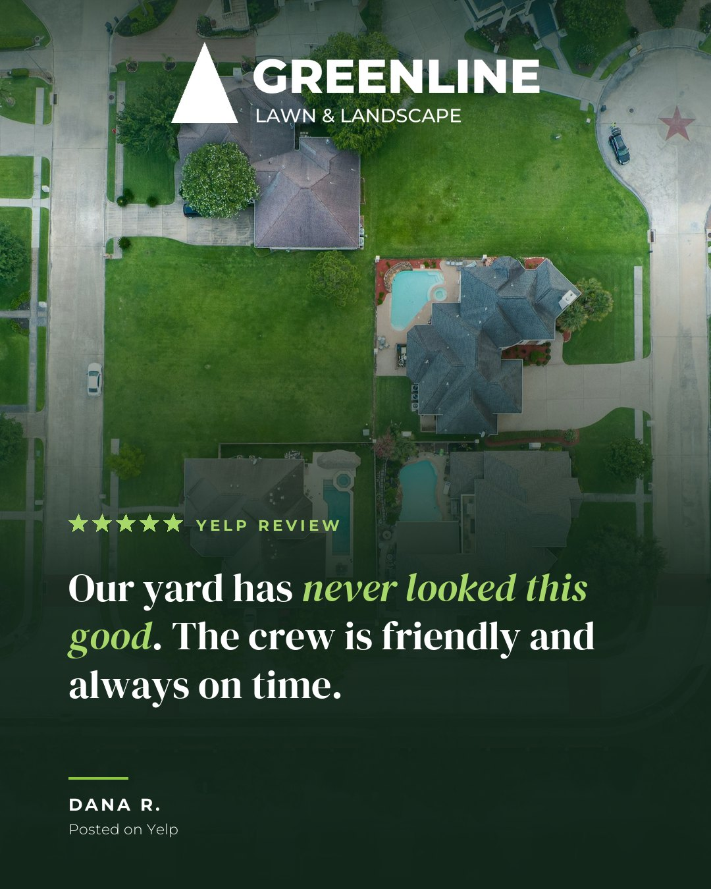</td>
<td>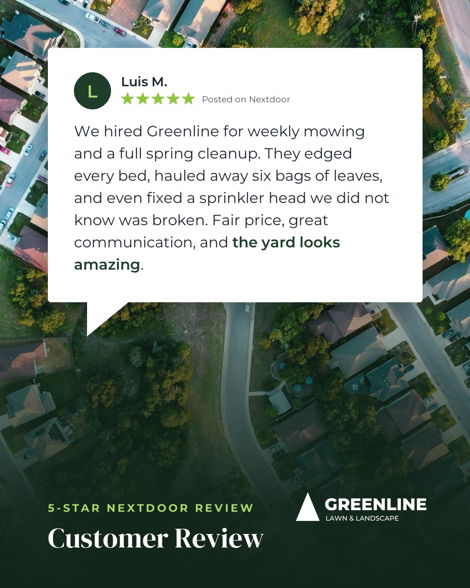</td>
<td>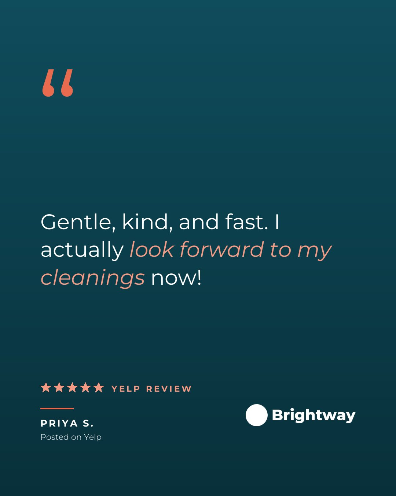</td>
<td>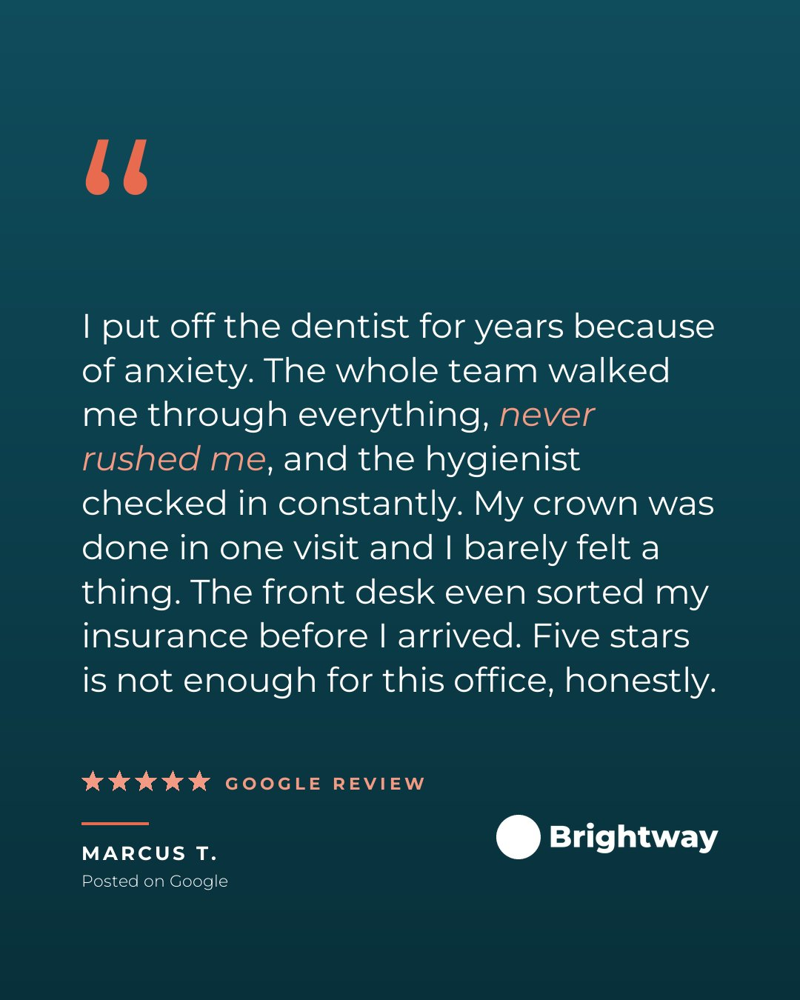</td>
</tr>
</table>

---

## Setup (5 minutes, one time)

### Step 1: Download this file

👉 **[Download `review-posts.zip`](https://github.com/javiervillag/review-posts/raw/main/review-posts.zip)**

Leave it as a .zip. Don't unzip it.

### Step 2: Add it to Claude

We recommend the **Claude desktop app with Cowork** ([free download](https://claude.com/download)). Cowork can open your website and review pages for you.

1. In Claude, click **Customize**, then **Skills**.
2. Click **+**, then **Create skill**, then **Upload a skill**.
3. Pick **`review-posts.zip`**.
4. Make sure its switch is **on**.
5. Go to **Settings**, then **Capabilities**, and turn on **"Code execution and file creation"** (it may be called "Create and edit files").

> 💡 **On the free Claude plan?** It still works. You'll paste your reviews into the chat yourself, and send your logo if Claude can't open your website. Cowork and the browser features need a paid plan (Pro or higher).

<b>Using ChatGPT instead? Click here.</b>

- **If your ChatGPT has "Skills"** (Business, Enterprise or Edu plans): open **Skills**, click **Create**, then **Upload from your computer**, and pick the zip.
- **If you don't see "Skills":** start a new chat, attach the zip with the paperclip, and type: **"Unzip this and follow the SKILL.md inside to set up review posts for my business."**

### Step 3: Say hi

> **Set up review posts for my business**

Claude will ask for two things:
1. **Your business name and website**
2. **Where your reviews are:** Google, Yelp, BBB, Facebook, Trustpilot, Houzz, Angi, Nextdoor, or your own website. Paste the links, or let it find them.

Then it will:
- 🎨 **Pull your brand** from your website: logo, colors and fonts.
- 📸 **Pick background photos:** your own (from your website, or ones you send) or free stock photos that fit your business and area.
- 👀 **Show you the looks** (big quote, review card, brand color, carousel) with your logo, so you can pick a favorite.
- ✍️ **Set up your captions:** your phone number or booking link, plus a few hashtags.

---

## Every week: just ask

> **Make review posts**

You get:
- 🖼️ **Posts for new 5-star reviews only.** Reviews already turned into posts are skipped.
- ✍️ **A caption** for each post
- 📋 **An approval sheet** that opens in Excel or Google Sheets, with Approve and Posted columns

**It never posts anything.** You choose what goes out and when.

---

## Change anything, any time, just by asking

- 📸 *"Use these photos as backgrounds"*, or *"remove the photo with the pool"*
- 🎨 *"Make the logo bigger"*, or *"change the gold to our orange"*
- 🧩 *"Only use the review card look"*, or *"no carousels"*
- ⭐ *"Add our Yelp reviews"*
- ✍️ *"End captions with 'Book online at…'"*

## Good to know

- ✏️ **Word for word:** reviews are never rewritten. The one exception: some sites (BBB) hide staff names. Those become a plain phrase like "The owner", and every change is listed in the approval sheet.
- ⭐ **5-star only**, unless you ask for 4-star reviews too.
- 📷 **Customer photos:** if a reviewer attached a photo of the work, it becomes the background for their post.
- 🖼️ **Photos:** the skill uses only your own photos, or free stock photos that allow commercial use (credited in a credits file). It never takes images from Google Images or competitors.

---

Example posts: WorleyByrd Roofing &amp; Restoration (logo, photos and brand are theirs; reviews are public). The landscaper and dentist brands are made up. Neighborhood photos are from Unsplash. Fonts: Playfair Display, Poppins and Raleway (SIL Open Font License, license files included). Code: MIT License.
